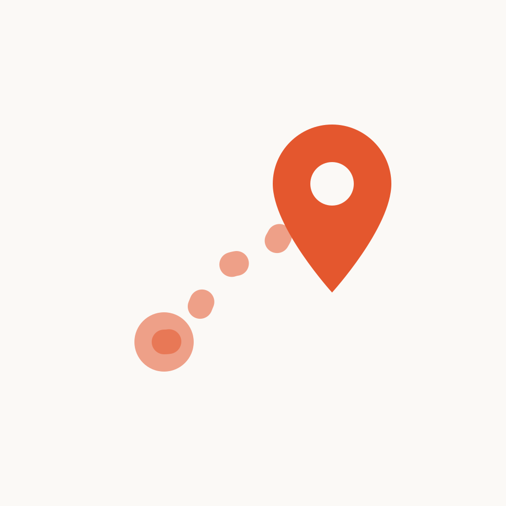
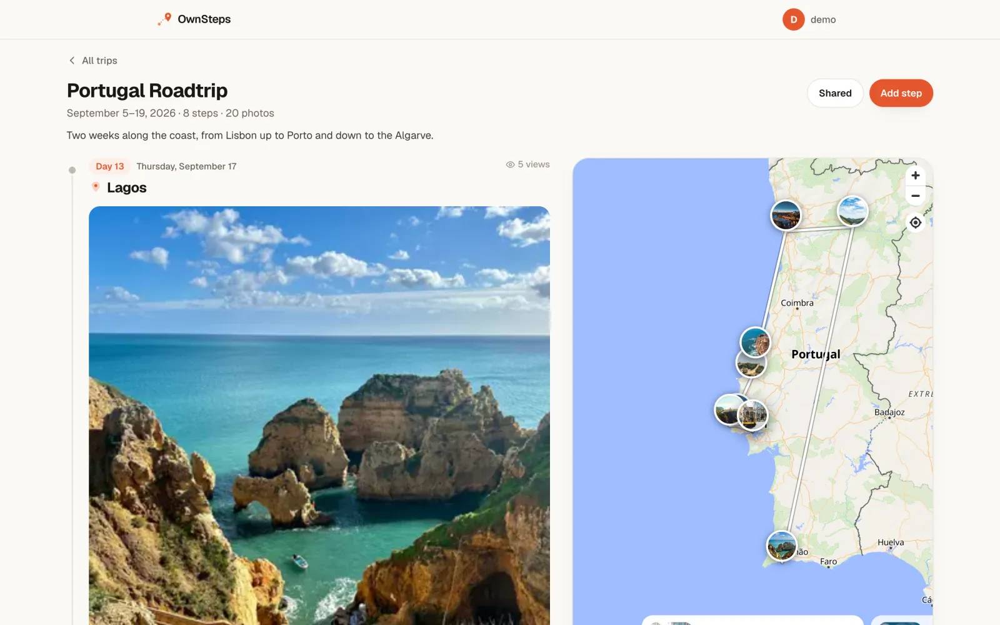
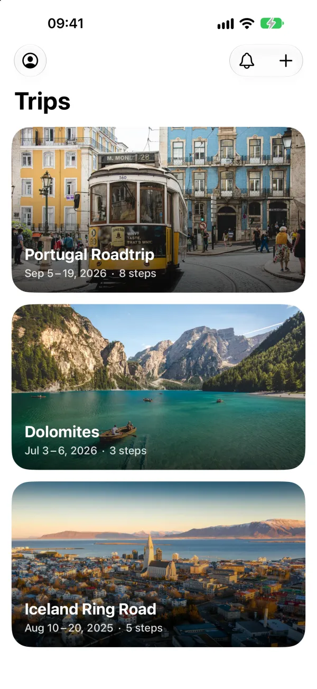
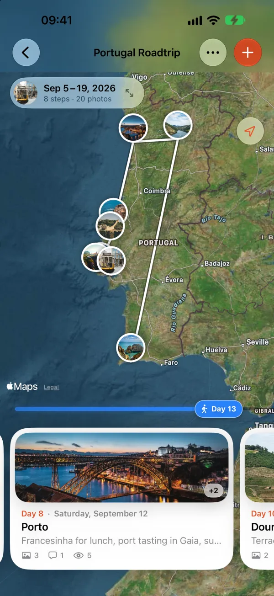
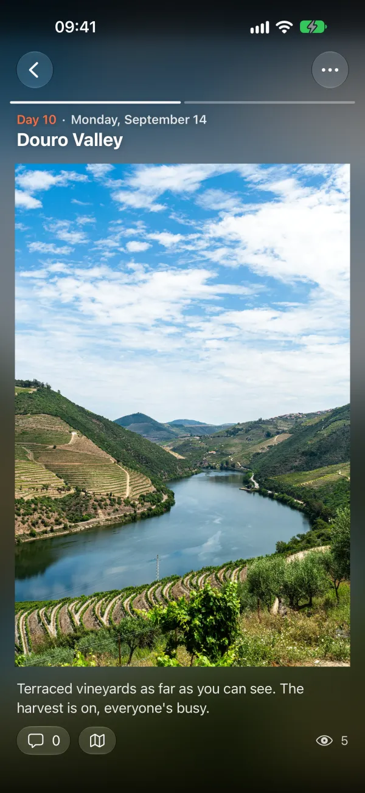
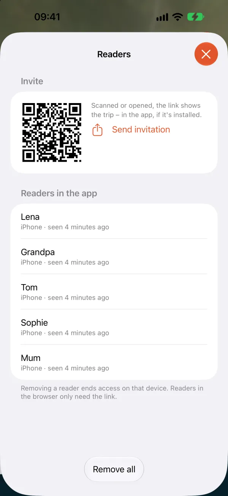
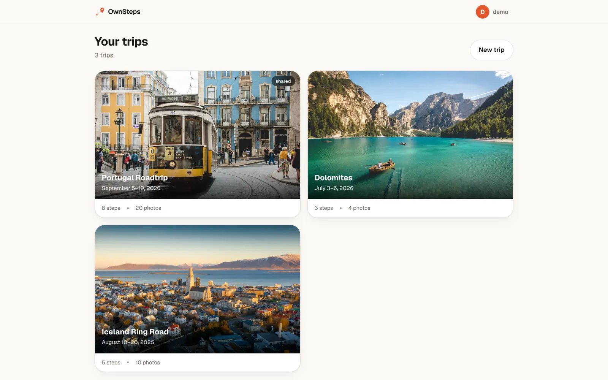

<p align="center">
  
</p>

<h1 align="center">OwnSteps</h1>

<p align="center">
  <b>A travel journal on your own server – photos, map and stories for the people back home.</b>
</p>

<p align="center">
  <a href="CHANGELOG.md"></a>
  <a href="https://github.com/RainerZufall00/ownsteps/pkgs/container/ownsteps"></a>
  <a href="LICENSE"></a>
</p>

<!-- TODO: once the app is live, add the App Store badge here:
<p align="center">
  <a href="https://apps.apple.com/app/idXXXXXXXXXX">
    
  </a>
</p>
-->

<p align="center">
  <a href="https://rainerzufall00.github.io/ownsteps/support"><b>Get started &amp; support</b></a> ·
  <a href="docs/USER-GUIDE.md">User guide</a> ·
  <a href="docs/SELF-HOSTING.md">Self-hosting</a> ·
  <a href="https://github.com/RainerZufall00/ownsteps/releases">Releases</a>
</p>

<p align="center">
  
</p>

<p align="center">
  
  
  
  
</p>

## 💡 What it is

I love how [Polarsteps](https://www.polarsteps.com) keeps family and friends up
to date on a trip. I just didn't want to hand all those photos to a company. So
OwnSteps does the same on a server you run yourself: upload photos, write a few
lines, and everything lands on a map and in a timeline. Whoever should follow
along gets a secret link – no account, no sign-up.

> **Unofficial project.** OwnSteps is independent and not affiliated with or
> endorsed by Polarsteps.

## ✨ Features

- 📸 **Place and time from the photos** – a step is saved from the first photo on
- 🗺️ **Route on the map** – flip through the steps as stories
- 👨‍👩‍👧 **Readers without accounts** – a link or QR code, optionally with a password
- 💬 **Comments and view counts** – and news in the apps, without a push service
- ✈️ **Made for the road** – offline reading, uploads that wait for a connection, videos up to 400 MB
- 💾 **Keep it** – export a trip as an offline album or send it to Immich
- 📱 **Everywhere** – web, native iPhone, iPad and Android apps, English and German
- 📦 **One container** – SQLite plus a folder of images, no tracking, nothing goes to third parties

<p align="center">
  
</p>

## 🚀 Quick start

All you need is Docker with the compose plugin (amd64 or arm64):

```bash
mkdir ownsteps && cd ownsteps
curl -fsSLO https://raw.githubusercontent.com/RainerZufall00/ownsteps/main/docker-compose.yml
curl -fsSL -o .env https://raw.githubusercontent.com/RainerZufall00/ownsteps/main/.env.example
```

Set at least `PUBLIC_URL` in `.env`, then:

```bash
docker compose up -d
```

OwnSteps runs on port 2555, and `/setup` creates the first account. To update:
`docker compose pull && docker compose up -d`.

## 📚 Docs

- **[User guide](docs/USER-GUIDE.md)** – trips, steps, sharing, videos, the map, the apps
- **[Self-hosting](docs/SELF-HOSTING.md)** – maps, OIDC, reverse proxy, API, backups, updating
- **[Architecture](docs/ARCHITECTURE.md)** – data model, flows and the reasoning behind every decision
- **[Contributing](CONTRIBUTING.md)** – development setup, releases, pull requests
- **[iOS](ios/README.md)** and **[Android](android/README.md)** – building the apps
- **[Changelog](CHANGELOG.md)** · **[Issues](https://github.com/RainerZufall00/ownsteps/issues)** · **[Security](SECURITY.md)** · **[Privacy policy](https://rainerzufall00.github.io/ownsteps/privacy)**

## License

Server and web UI: [AGPL-3.0](LICENSE) – if you run a modified version for
others, you have to offer them its source code. Apps in `ios/` and `android/`:
[MPL-2.0](ios/LICENSE). Demo photos: see [credits](docs/CREDITS.md).
*Polarsteps* is a trademark of its respective owner.

## ☕ Support

OwnSteps is free, without ads or subscriptions. If it keeps your family posted
on your next trip, you can buy me a coffee:

<a href="https://buymeacoffee.com/rainerzufall00">
  
</a>
